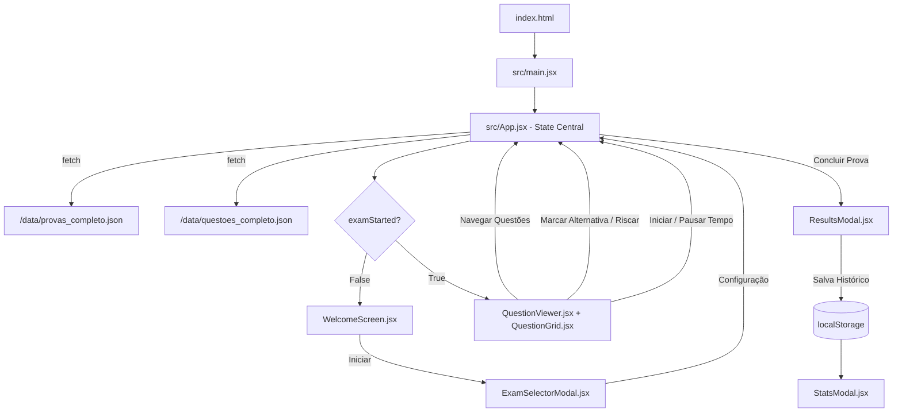

# 📘 AGENTS.md — Documento Mestre de Referência e Arquitetura

> **Este documento é a fonte canônica de verdade para desenvolvedores humanos e agentes de IA (Antigravity, Gemini, Claude, Cursor, Copilot, etc.) que forem realizar manutenção, refatoração ou evolução neste repositório.**
> 
> **Data de Emissão:** Outubro de 2026  
> **Versão Estável de Referência:** 1.0.0 (Tag Git: `v1.0.0-checkpoint`)  
> **Nome do Projeto:** EstudeAqui (Simulador INEP / ENEM / Vestibulares)

---

## 1. Visão Geral e Propósito do Projeto

O **EstudeAqui** é uma aplicação web SPA (*Single Page Application*) com comportamento desktop-like de alta performance, desenvolvida para simular com fidelidade as provas do **ENEM (2015 a 2024)**, além de vestibulares tradicionais e concursos públicos.

### Pilares Fundamentais
1. **Foco Cognitivo Máximo (Estética Windows XP / Clássica P&B):**
   - Interface inspirada em softwares desktop utilitários clássicos (estilo Win32 / Windows XP / 2000).
   - Paleta de cores deliberadamente restrita a tons de cinza, preto e branco, com suporte nativo a **Baixo Contraste**, **Alto Contraste Claro**, **Modo Escuro** e **Alto Contraste Escuro**.
   - Zero elementos visuais distrativos modernos (sem gradientes chamativos, sem banners, sem notificações invasivas).
2. **Autonomia e Resiliência Offline:**
   - A plataforma funciona de forma 100% autônoma no navegador cliente.
   - Toda a base de mais de 1.800 questões e gabaritos oficiais é servida localmente via arquivos JSON estáticos e pode ser executada sem dependência de internet ou backends externos.
3. **Fidelidade às Provas Oficiais:**
   - Preservação da numeração oficial, textos de apoio, fórmulas, figuras e gabaritos oficiais.
   - Suporte a marcação de questões para revisão (*flag*), eliminação/riscado de alternativas (*strikethrough*), cronômetro oficial com controle de início/pausa e relatório analítico de desempenho por disciplina.

---

## 2. 🛡️ Regras Invioláveis do Projeto (Anti-Drift / Guardiões de Propósito)

Qualquer desenvolvedor ou Agente de IA que for alterar o projeto **DEVE** seguir rigorosamente as regras abaixo:

1. **PROIBIDO Substituir a Estética Retrô por Design Moderno Genérico:**
   - Não converta a interface para "Material Design", Tailwind genérico ou designs coloridos modernos de landing pages.
   - Os controles devem manter o visual bevel 3D clássico (`inset`, `outset`, barras de título com degradê de tons de cinza, caixas de diálogo modais com molduras sólidas).
2. **PROIBIDO Adicionar Dependências Pesadas Desnecessárias:**
   - O projeto mantém um bundle leve usando apenas **React 18** e **Vite**.
   - Toda a estilização é centralizada em Vanilla CSS com Custom Properties em `src/index.css`. Não instale TailwindCSS, Bootstrap, Styled Components ou bibliotecas de UI pesadas (como MUI ou AntD) sem requisição expressa do usuário.
3. **NÃO Quebrar a Execução Offline:**
   - Nunca faça a aplicação depender de chamadas síncronas a APIs externas de terceiros para carregar o banco de dados principal de simulados. O carregamento padrão deve sempre apontar para `/data/provas_completo.json` e `/data/questoes_completo.json` (com fallback para `_inep.json`).
4. **Preservar a Reclassificação das Disciplinas:**
   - No ENEM, as questões do caderno oficial agrupam áreas amplas (Linguagens, Humanas, Natureza, Matemática). No banco do EstudeAqui, foi feito um tratamento algorítmico criterioso para categorizar cada questão com sua disciplina específica (ex: *História, Geografia, Filosofia, Sociologia, Biologia, Física, Química*). **Nunca reverta essa classificação para etiquetas genéricas como "Informática"**.
5. **Manter o Comportamento do Cronômetro:**
   - Por especificação de usabilidade, ao abrir uma prova o cronômetro começa **desativado/pausado** até que o estudante clique expressamente no botão **"Iniciar Cronômetro"** ou **"Começar Agora"**, permitindo leitura prévia das instruções sem consumo injusto de tempo.
6. **Preservar a Organização por Blocos Oficiais de Conhecimento e Responsividade Mobile-First (conforme `skills.md`):**
   - No ENEM, as provas devem sempre respeitar a divisão canônica em blocos:
     - **1º Domingo:** 1º Bloco: Língua Estrangeira (Inglês ou Espanhol - 5q) ➔ 2º Bloco: Linguagens e Códigos (40q) ➔ 3º Bloco: Ciências Humanas (45q).
     - **2º Domingo:** 1º Bloco: Ciências da Natureza (45q) ➔ 2º Bloco: Matemática (45q).
   - A interface deve seguir a arquitetura **Mobile-First** com touch targets de no mínimo 44px, safe areas (`env(safe-area-inset-*)`), `touch-action: manipulation;`, e media queries progressivas (`@media (min-width: ...)`), preservando a estética retrô Windows XP.

---

## 3. Stack Tecnológico

| Camada | Tecnologia | Versão | Função no Projeto |
| :--- | :--- | :--- | :--- |
| **Framework UI** | React | `^18.3.1` | Gerenciamento de componentes reativos e estado da SPA |
| **Renderizador DOM** | ReactDOM | `^18.3.1` | Montagem da árvore DOM |
| **Build Tool & Bundler** | Vite | `^6.0.7` | Servidor de desenvolvimento rápido e bundler Rollup/ESBuild |
| **Vite Plugin** | @vitejs/plugin-react | `^4.3.4` | Suporte a JSX e Fast Refresh do React |
| **Estilização** | Vanilla CSS3 | Nativo | Design system completo, variáveis CSS e temas em `src/index.css` |
| **Scripts de Dados** | Node.js (ESM / CJS) | 18+ | Scripts de raspagem e reclassificação de disciplinas (`scripts/*.js`, `*.cjs`) |
| **Scripts de Banco** | Python 3 + SQLite3 | 3.10+ | Conversão dos dados JSON para banco de dados relacional SQLite (`scripts/gerar_sqlite.py`) |
| **Automação Windows** | PowerShell & Batch | Nativo | Servidor HTTP estático offline e iniciador de 1 clique (`public/`) |

---

## 4. Estrutura de Diretórios e Arquivos

```text
e:/Projects/EstudeAqui/
├── .git/                                # Repositório Git com histórico e tags de checkpoint
├── .gitignore                           # Ignora node_modules, dist, logs e zip backups
├── AGENTS.md                            # [ESTE ARQUIVO] Documento mestre de arquitetura para Desenvolvedores e Agentes
├── README.md                            # Guia rápido de introdução e instruções gerais
├── index.html                           # Entrypoint HTML da SPA (com meta tags e ícone SVG)
├── package.json                         # Dependências e scripts npm (dev, build, preview)
├── package-lock.json                    # Lockfile de dependências
├── vite.config.js                       # Configuração do Vite com plugin do React
│
├── backup/                              # Snapshots e checkpoints comprimidos (.zip)
│   ├── checkpoint_v1.0_estavel_20261007.zip # Arquivo de recuperação autônomo offline
│   └── ...                              # Backups históricos
│
├── data/                                # Bases de dados em JSON e SQLite
│   ├── provas_completo.json             # Lista de todas as provas disponíveis com metadados
│   ├── questoes_completo.json           # Banco completo de questões com gabaritos e alternativas
│   ├── questoes_completo.db             # Banco SQLite estruturado
│   ├── provas_inep.json                 # Versão reduzida apenas com provas oficiais do INEP
│   ├── questoes_inep.json               # Versão reduzida das questões do INEP
│   └── questoes_inep.db                 # Banco SQLite reduzido do INEP
│
├── public/                              # Arquivos estáticos servidos na raiz do web server
│   ├── data/                            # Espelho dos JSONs para acesso direto via fetch('/data/...')
│   ├── INICIAR_ESTUDEAQUI.bat           # Script Windows para subir o servidor e abrir no navegador
│   ├── servidor_offline.ps1             # Servidor HTTP nativo em PowerShell (sem dependência de Node)
│   └── LEIA-ME.txt                      # Instruções simples para o usuário final
│
├── scripts/                             # Automações de extração e tratamento de dados
│   ├── extrair_banco_inep.js            # Script para extração de provas e autenticação via API
│   ├── extrair_todas_questoes.js        # Script de extração em lote com controle de paginação
│   ├── reclassificar_disciplinas.cjs    # Algoritmo de correção de disciplinas para a grade ENEM
│   └── gerar_sqlite.py                  # Script Python que consome JSON e cria tabelas no SQLite
│
└── src/                                 # Código-fonte da aplicação React
    ├── main.jsx                         # Ponto de entrada React (createRoot)
    ├── App.jsx                          # Componente raiz, gestor central de estado e regras de negócio
    ├── index.css                        # Design System retrô completo (estilo Windows XP / P&B / Mobile-First)
    ├── utils/                           # Utilitários de classificação e lógica de prova
    │   └── blockClassifier.js           # Classificação e ordenação canônica dos blocos oficiais de conhecimento
    └── components/                      # Componentes modulares da interface
        ├── TitleBar.jsx                 # Barra de título com botões de janela clássicos
        ├── MenuBar.jsx                  # Menu horizontal clássico (Arquivo, Simulado, Ferramentas, etc.)
        ├── Toolbar.jsx                  # Barra de atalhos rápidos com controles de cronômetro e ações
        ├── WelcomeScreen.jsx            # Tela de boas-vindas com cartões para início rápido
        ├── QuestionViewer.jsx           # Exibição da questão, alternativas, riscamento, badges de bloco e gabarito
        ├── QuestionGrid.jsx             # Grade de navegação com abas de blocos oficiais e progresso
        ├── StatusBar.jsx                # Barra de rodapé com estatísticas da sessão e atalhos de tema
        ├── ExamSelectorModal.jsx        # Modal com seleção de língua estrangeira e divisão por blocos
        ├── ResultsModal.jsx             # Relatório analítico pós-prova com desempenho por bloco oficial e matérias
        ├── StatsModal.jsx               # Histórico acumulado de desempenho em simulados anteriores
        └── HelpModal.jsx                # Janela de ajuda, atalhos de teclado e sobre o sistema
```

---

## 5. Fluxo de Dados e Ciclo de Vida da Aplicação



### Estados Centrais em `src/App.jsx`:
1. **Dados Globais:**
   - `provasList`: Lista de metadados das provas disponíveis.
   - `allQuestions`: Catálogo com todas as questões carregadas em memória.
2. **Sessão do Simulado:**
   - `examStarted`: Booleano que alterna entre a `WelcomeScreen` e o ambiente de prova.
   - `mode`: Modo de resolução (`'simulado'` com cronômetro ou `'treino'` com gabarito imediato).
   - `currentExam`: Objeto com metadados da prova selecionada (código, nome, banca).
   - `examQuestions`: Lista das questões filtradas e ordenadas pertencentes à prova atual.
   - `currentIndex`: Índice inteiro (base 0) da questão sendo exibida no momento.
3. **Interações do Aluno:**
   - `userAnswers`: Dicionário chaveado pelo ID da questão (`{ [questionId]: 'A' | 'B' | ... }`).
   - `flaggedSet`: `Set` de IDs de questões marcadas para revisão pelo aluno.
   - `strikethroughMap`: Mapeamento de alternativas eliminadas/riscadas (`{ [questionId]: ['A', 'C'] }`).
4. **Cronômetro:**
   - `timerSeconds`: Segundos restantes.
   - `isTimerStarted`: Booleano; inicia como `false` até o acionamento explícito.
   - `isPaused`: Booleano para pausar a contagem regressiva.
5. **Configurações e Persistência:**
   - `theme`: Salvo em `localStorage.getItem('estudeaqui_theme')`.
   - `fontSize`: Salvo em `localStorage.getItem('estudeaqui_font')`.
   - `history`: Array de simulados concluídos salvo em `localStorage.getItem('estudeaqui_history')`.

---

## 6. Modelos de Dados (Schemas)

### Objeto Prova (`provas_completo.json`)
```json
{
  "codigo": 1001,
  "nome": "ENEM 2024 - Caderno Azul - Dia 1",
  "ano": 2024,
  "dia": 1,
  "caderno": "Azul",
  "categoria": "ENEM",
  "categoriaId": "enem",
  "banca": "INEP",
  "totalQuestoes": 90,
  "linkProva": "https://...",
  "linkGabarito": "https://..."
}
```

### Objeto Questão (`questoes_completo.json`)
```json
{
  "id": 50123,
  "provaId": 1001,
  "numeroQuestao": 1,
  "disciplina": "História",
  "areaConhecimento": "Ciências Humanas e suas Tecnologias",
  "categoriaId": "enem",
  "enunciado": "<p>Texto da questão com contexto histórico...</p>",
  "imagens": [
    "https://..."
  ],
  "alternativas": {
    "A": "Alternativa de teste A",
    "B": "Alternativa de teste B",
    "C": "Alternativa de teste C",
    "D": "Alternativa de teste D",
    "E": "Alternativa de teste E"
  },
  "gabarito": "C"
}
```

---

## 7. Temas e Sistema de Cores (`src/index.css`)

O tema é controlado pelo atributo `data-theme` no elemento `<body>`:

1. **`classic-bw` (Padrão):** Visual clássico Windows 98/2000 em escala de cinza e chanfros tridimensionais suaves.
2. **`high-contrast-light`:** Alto contraste preto no branco (#FFFFFF e #000000 estritos), otimizado para leitura nítida e acessibilidade visual.
3. **`dark-mode`:** Modo escuro em escala de cinza suave para reduzir fadiga visual em estudos noturnos.
4. **`high-contrast-dark`:** Alto contraste escuro com linhas brancas nítidas em fundo preto absoluto.

---

## 8. Como Executar e Testar o Projeto

### Modo de Desenvolvimento (Node.js + Vite):
```bash
# Instalação das dependências
npm install

# Iniciar servidor local Vite
npm run dev

# Gerar build de produção
npm run build

# Pré-visualizar o build de produção
npm run preview
```

### Modo de Execução Offline Direto no Windows (Sem Node.js):
1. Execute o arquivo [public/INICIAR_ESTUDEAQUI.bat](file:///e:/Projects/EstudeAqui/public/INICIAR_ESTUDEAQUI.bat).
2. O script inicializará um servidor HTTP leve através do PowerShell ([public/servidor_offline.ps1](file:///e:/Projects/EstudeAqui/public/servidor_offline.ps1)) e abrirá o navegador padrão no endereço `http://localhost:8080`.

---

## 9. 📌 CHECKPOINT E PROCEDIMENTO DE RESTAURAÇÃO (Rollback)

Para garantir a preservação do projeto e evitar que futuras alterações descaracterizem o sistema ou introduzam bugs irreversíveis, foram criadas duas barreiras de segurança:

### 1. Checkpoint via Git (Restauração Rápida de Código)
O estado estável atual do repositório está marcado com a tag Git:
```
v1.0.0-checkpoint
```

#### Para visualizar o ponto do checkpoint:
```bash
git show v1.0.0-checkpoint
```

#### Para reverter o projeto de volta a este checkpoint exato:
```bash
# Descarta quaisquer alterações não salvas e volta ao estado do checkpoint:
git reset --hard v1.0.0-checkpoint
git clean -fd
```

#### Para criar uma nova ramificação a partir do checkpoint:
```bash
git checkout -b branch-restaurada v1.0.0-checkpoint
```

### 2. Checkpoint Físico Autônomo (.ZIP)
Existe uma cópia snapshot completa de segurança gerada na pasta:
```
e:/Projects/EstudeAqui/backup/checkpoint_v1.0_estavel_20261007.zip
```
Este arquivo comprimido contém todos os códigos-fonte (`src`), assets, scripts, arquivos HTML/CSS e bancos de dados (`data`), permitindo a restauração instantânea do sistema mesmo em computadores sem Git instalado.

---

## 10. Checklist de Validação Pré-Commit para Agentes e Desenvolvedores

Antes de concluir qualquer tarefa ou propor alterações neste repositório, execute este checklist:

- [ ] A aplicação compila sem erros (`npm run build`).
- [ ] O visual continua fiel ao estilo clássico Windows XP em tons de cinza/P&B.
- [ ] As 3 abas de seleção de prova (Individual, Misto por Disciplina, Combo) funcionam corretamente.
- [ ] A reclassificação das disciplinas (História, Geografia, Física, etc.) permanece intacta.
- [ ] O cronômetro inicia desativado e só avança após comando do usuário.
- [ ] O gabarito instantâneo funciona corretamente apenas no modo Treino e nunca antecipa respostas no modo Simulado.
- [ ] O cálculo e a persistência de histórico no `localStorage` permanecem consistentes.
