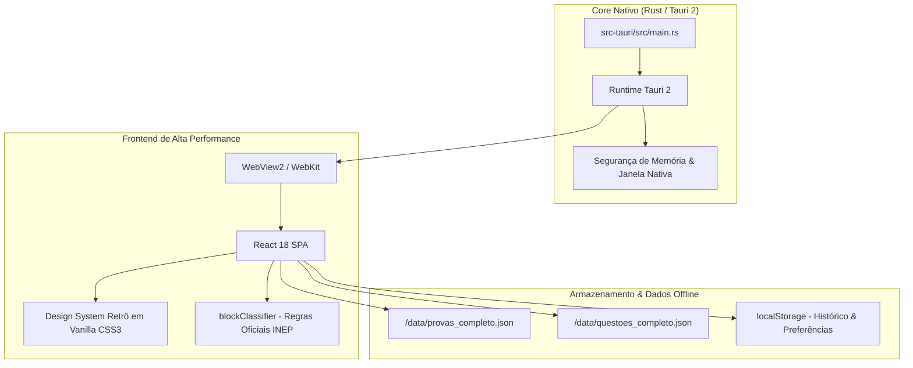

# 🏛️ EstudeAqui — Simulador Oficial INEP / ENEM / Vestibulares

<p align="center">
  
</p>

<p align="center">
  <strong>Simulador de Provas para Ajudar Estudantes nas provas de Concurso, Vestibulares e Enem.</strong><br>
  Construído com <strong>Rust (Tauri 2)</strong>, <strong>React 18</strong> e arquitetura <strong>100% Offline-First</strong>.
</p>

<p align="center">
  <a href="https://github.com/thezenba/EstudeAqui/releases"></a>
  <a href="https://rust-lang.org"></a>
  <a href="https://tauri.app"></a>
  <a href="https://react.dev"></a>
  
  
</p>

---

## 📌 Sumário

1. [Visão Geral](#-visão-geral)
2. [Pilares de Design e Foco Cognitivo](#-pilares-de-design-e-foco-cognitivo)
3. [Recursos Principais](#-recursos-principais)
4. [Download e Instalação](#-download-e-instalação)
5. [Arquitetura Tecnológica](#-arquitetura-tecnológica)
6. [Execução e Desenvolvimento Local](#-execução-e-desenvolvimento-local)
7. [Automação Multiplataforma (CI/CD)](#-automação-multiplataforma-cicd)
8. [Documentação Canônica de Arquitetura](#-documentação-canônica-de-arquitetura)
9. [Segurança e Procedimento de Rollback](#-segurança-e-procedimento-de-rollback)
10. [Licença e Créditos](#-licença-e-créditos)

---

## 📖 Visão Geral

O **EstudeAqui** é uma aplicação de simulação de exames em larga escala desenvolvida para reproduzir com máxima fidelidade o ambiente, as regras e a estrutura cognitiva das provas oficiais do **ENEM (2015 a 2024)**, além de vestibulares tradicionais e concursos públicos.

Diferente de plataformas web convencionais repletas de distrações, anúncios e elementos visuais invasivos, o EstudeAqui adota uma filosofia **utilitária clássica** — priorizando tempo de resposta instantâneo, legibilidade tipográfica impecável e autonomia completa sem depender de conexão com a internet.

---

## 🧠 Pilares de Design e Foco Cognitivo

* **Estética Clássica Win32 / Windows XP em Escala de Cinza:**
  Chanfros tridimensionais sutis (`inset`/`outset`), controles táteis nítidos e zero gradientes saturados.
* **4 Modos de Contraste e Acessibilidade:**
  * `Clássico P&B` (Padrão visual balanceado)
  * `Alto Contraste Claro` (Preto puro sobre branco absoluto para nitidez sob luz solar)
  * `Modo Escuro` (Tons de cinza escuro para redução de fadiga visual noturna)
  * `Alto Contraste Escuro` (Linhas de alto contraste em fundo preto OLED)
* **Organização Oficial por Blocos de Conhecimento:**
  * **1º Dia do ENEM:** Língua Estrangeira (Inglês ou Espanhol - 5q) ➔ Linguagens e Códigos (40q) ➔ Ciências Humanas (45q).
  * **2º Dia do ENEM:** Ciências da Natureza (45q) ➔ Matemática (45q).
* **Ergonomia Mobile-First & Desktop Híbrido:**
  Touch targets generosos (mínimo de 44px), conformidade com safe areas de telas modernas (`100dvh`) e suporte a atalhos rápidos de teclado no desktop.

---

## 🚀 Recursos Principais

| Recurso | Descrição |
| :--- | :--- |
| **⏱️ Cronômetro Oficial com Espera Ativa** | O tempo de prova inicia pausado para permitir a leitura prévia das instruções pelo candidato, avançando apenas sob comando expresso. |
| **✏️ Eliminação de Alternativas (*Strikethrough*)** | Permite riscar alternativas descartadas para reduzir a carga cognitiva durante o raciocínio. |
| **🚩 Marcação para Revisão (*Flag*)** | Sinaliza questões duvidosas na barra e na grade para conferência posterior antes da entrega. |
| **📊 Modos de Resolução** | Alternância entre o **Modo Simulado** (sem gabarito durante a prova e com emissão de relatório estatístico final) e o **Modo Treino** (gabarito e feedback imediato). |
| **🎲 Modos de Seleção de Provas** | Resolução de **Provas Individuais Oficiais**, **Simulado Misto por Disciplina** (questões sorteadas por matéria específica) e **Combos Personalizados**. |
| **📈 Relatório Analítico de Desempenho** | Diagnóstico pós-prova detalhado com acertos por disciplina (História, Geografia, Física, Química, Biologia, Matemática, etc.) e histórico persistente salvo localmente. |

---

## 📦 Download e Instalação

Escolha a modalidade de distribuição mais conveniente para o seu ambiente:

### 🪟 Windows

| Pacote | Arquivo | Tamanho | Descrição |
| :--- | :--- | :---: | :--- |
| **Instalador Oficial (Setup)** | `EstudeAqui_1.0.0_x64-setup.exe` | **~4.0 MB** | Assistente de instalação clássico NSIS com atalho na Área de Trabalho, Menu Iniciar e desinstalador nativo. |
| **Versão Portátil (Portable)** | `EstudeAqui_1.0.0_Portable_x64.zip` | **~4.6 MB** | Pacote autônomo sem necessidade de instalação. Descompacte e execute diretamente (ideal para pendrives). |
| **Binário Independente** | `EstudeAqui.exe` | **~10.5 MB** | Executável único compilado com Rust + WebView2. |

### 🐧 Linux

* **AppImage Universal:** `EstudeAqui_1.0.0_amd64.AppImage` (Executável portátil que roda com duplo clique no Ubuntu, Fedora, Debian, Arch, Mint e derivados).
* **Pacote Debian/Ubuntu:** `estudeaqui_1.0.0_amd64.deb`.

### 🍏 macOS

* **Imagem de Disco Universal:** `EstudeAqui_1.0.0_universal.dmg` (Binário universal compilado nativamente para chips **Apple Silicon (M1/M2/M3/M4)** e processadores **Intel**).

> 💡 *Baixe as versões mais recentes na aba [Releases](https://github.com/thezenba/EstudeAqui/releases) do repositório.*

---

## 🛠️ Arquitetura Tecnológica



* **Core Nativo:** **Tauri 2 (Rust 1.99)** — Fornece alta velocidade de inicialização, consumo mínimo de memória RAM (~35 MB) e empacotamento seguro em código de máquina nativo.
* **Camada de Interface:** **React 18.3** montado sobre o bundler **Vite 6**.
* **Estilização:** **Vanilla CSS3** com CSS Custom Properties em `src/index.css`. Zero dependências pesadas de frameworks utilitários externos (sem Tailwind, Bootstrap ou Styled Components).
* **Camada de Dados:** Bases estruturadas em JSON estático e SQLite para consulta offline instantânea.

---

## 💻 Execução e Desenvolvimento Local

### Pré-requisitos
* [Node.js](https://nodejs.org/) versão 18+
* [Rust](https://rust-lang.org/) versão 1.80+ com toolchain MSVC (Windows) ou C++ Build Tools

### 1. Clonar e Instalar Dependências
```bash
git clone https://github.com/thezenba/EstudeAqui.git
cd EstudeAqui
npm install
```

### 2. Executar em Modo Desktop Nativo (Tauri + Rust)
```bash
# Executa a janela nativa do aplicativo com hot-reload ativo
npm run tauri:dev
```

### 3. Compilar os Pacotes de Produção (Windows)
```bash
# Compilar o instalador oficial (Setup NSIS de ~4 MB)
npm run tauri:build

# Compilar a versão portátil (.zip de ~4.6 MB)
npm run tauri:portable

# Compilar apenas o binário .exe direto sem instalador
npm run tauri:build -- --no-bundle
```

### 4. Execução Web (Navegador)
```bash
# Servidor local de desenvolvimento
npm run dev

# Compilação de assets estáticos web
npm run build
```

### 5. Modo Offline Direto sem Node.js (Windows)
Dê um duplo clique no arquivo:
```text
public/INICIAR_ESTUDEAQUI.bat
```
O script executa um servidor HTTP leve em PowerShell nativo e abre o navegador automaticamente na porta local `8080`.

---

## 🌐 Automação Multiplataforma (CI/CD)

O repositório conta com uma esteira automatizada em [.github/workflows/release.yml](file:///e:/Projects/EstudeAqui/.github/workflows/release.yml).

Ao criar e enviar uma tag de versão git:
```bash
git tag v1.0.0
git push origin v1.0.0
```
O GitHub Actions dispara automaticamente máquinas virtuais **Windows**, **macOS** e **Linux Ubuntu** em paralelo, gerando todos os instaladores (`.exe`, `.zip`, `.AppImage`, `.deb`, `.dmg`) e publicando o release completo de forma autônoma.

---

## 📚 Documentação Canônica de Arquitetura

Para desenvolvedores e agentes de IA que realizam manutenção no código-fonte, a fonte primária de verdade com regras invioláveis, contratos de dados e diretrizes de anti-drift é:

👉 **[AGENTS.md](file:///e:/Projects/EstudeAqui/AGENTS.md)**

Tópicos abordados em detalhes no [AGENTS.md](file:///e:/Projects/EstudeAqui/AGENTS.md):
* Guardiões de propósito e regras anti-drift do design retrô;
* Reclassificação criteriosa das matérias do ENEM (História, Geografia, Física, etc.);
* Estrutura canônica de árvore de arquivos e ciclo de vida do estado global (`src/App.jsx`);
* Procedimentos de rollback e restauração de integridade.

---

## 🔒 Segurança e Procedimento de Rollback

O projeto conta com barreiras rígidas para prevenção de regressões:

1. **Tag de Checkpoint Git Estável:**
   ```bash
   # Reverter com segurança para o ponto de referência estável v1.0.0
   git reset --hard v1.0.0-checkpoint
   git clean -fd
   ```
2. **Snapshot Físico Autônomo:**
   Existe uma cópia arquivada completa em `backup/checkpoint_v1.0_estavel_20261007.zip`.

---

## 📄 Licença e Créditos

* **Dados das Questões e Provas:** Instituto Nacional de Estudos e Pesquisas Educacionais Anísio Teixeira (**INEP / Ministério da Educação**).
* **Desenvolvimento e Arquitetura:** Projeto EstudeAqui.
* **Licença:** Distribuído para fins educacionais e estudo sem fins lucrativos.
